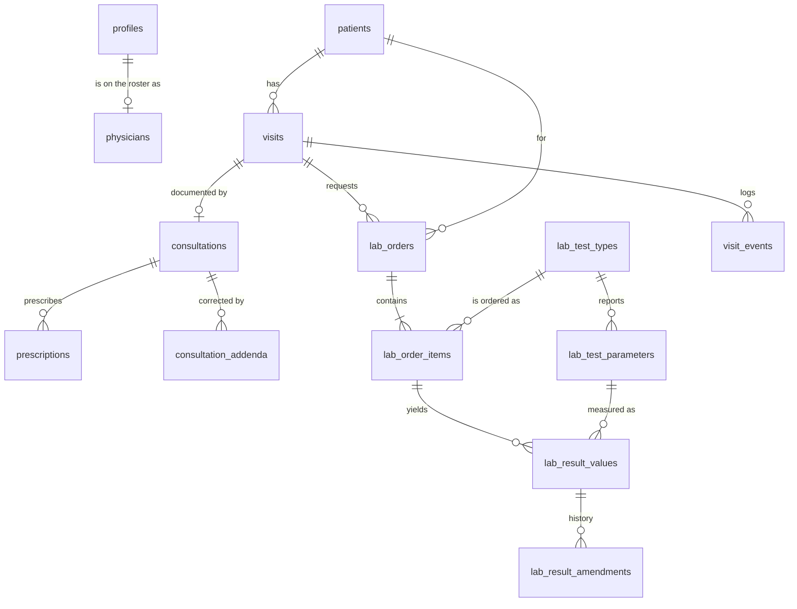
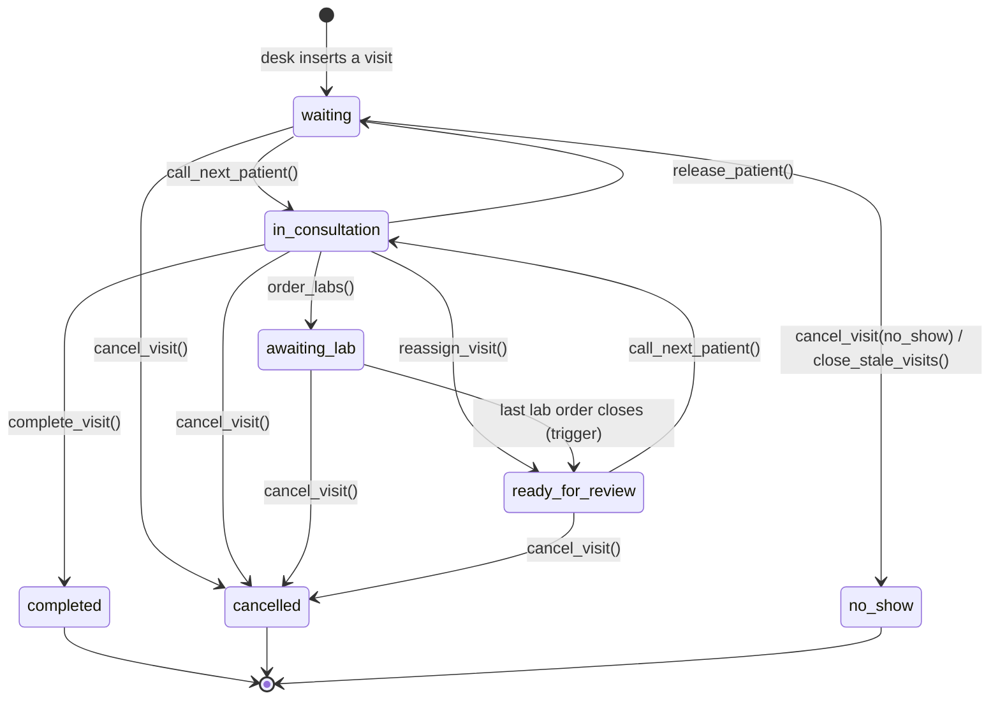

# Developer Guide: Outpatient Department Management System with EMR

This guide explains how the system works, from the database up to the screens. Read it before you change anything. Most of the system's rules live in the database, not in the Vue code, and a change that looks harmless in the UI can be refused by Postgres if you don't know why.

**Contents**

1. [What the system does](#1-what-the-system-does)
2. [Stack and local setup](#2-stack-and-local-setup)
3. [How the code is organized](#3-how-the-code-is-organized)
4. [Access control](#4-access-control)
5. [The database](#5-the-database)
6. [The visit lifecycle](#6-the-visit-lifecycle)
7. [The laboratory flow](#7-the-laboratory-flow)
8. [How the database protects itself](#8-how-the-database-protects-itself)
9. [Function and trigger reference](#9-function-and-trigger-reference)
10. [Live updates (Realtime)](#10-live-updates-realtime)
11. [The frontend, screen by screen](#11-the-frontend-screen-by-screen)
12. [Recipes: common changes](#12-recipes-common-changes)
13. [Gotchas](#13-gotchas)
14. [Testing and deployment](#14-testing-and-deployment)

---

## 1. What the system does

The Outpatient Department Management System with EMR digitizes a hospital's outpatient department (OPD) and keeps an integrated electronic medical record (EMR). It's built for a single public hospital. It takes a patient through one outpatient visit:

```
Register → Queue (FIFO) → Consultation → Laboratory → Results back to the doctor → Complete
```

It has four roles, and each role has its own workspace:

| Role | Lands on | Main job |
|---|---|---|
| **OPD Staff** | `/queue` | Registers patients, takes vitals, manages the waiting line |
| **Physician** | `/consultation` | Calls patients in, documents the visit, prescribes, orders labs |
| **Laboratory Technician** | `/laboratory` | Processes lab orders and releases results |
| **Administrator** | `/` (dashboard) | Monitors operations and manages users and roles |

---

## 2. Stack and local setup

| Layer | Technology |
|---|---|
| UI | Vue 3 (`<script setup>`, TypeScript), Vuetify 3 |
| State | Pinia |
| Routing | Vue Router 4 |
| Build | Vite 5 |
| Backend | Supabase: Postgres, Auth, Realtime, and PostgREST (the API) |
| Hosting | Vercel (static build) |

There is no custom backend server. The browser talks to Supabase directly. Every rule that must actually hold (who can see what, which status changes are legal) is enforced inside Postgres.

### Run it locally

```bash
npm install
cp .env.example .env    # then fill in the two values below
npm run dev             # http://localhost:5173
```

`.env`:

```
VITE_SUPABASE_URL=https://<project-ref>.supabase.co
VITE_SUPABASE_ANON_KEY=<anon / publishable key>
```

The anon key is public by design. Never put the `service_role` key in `.env` or on Vercel, because anything prefixed `VITE_` is shipped to the browser.

### Set up a Supabase project

1. Run the migrations in `supabase/migrations/` **in order** in the Supabase SQL editor: `0001` → `0006`. Every file can be re-run safely.
2. Sign up through the app, then make yourself admin in the SQL editor:
   ```sql
   update public.profiles
   set role_id = (select id from public.roles where key = 'admin')
   where email = 'you@example.com';
   ```
3. For development, turn off **Authentication → Sign In / Providers → Email → Confirm email**, so test accounts don't need a real inbox.
4. In **Authentication → URL configuration**, set the Site URL and add `<site>/reset-password` as a redirect URL.

### Useful scripts

| Command | What it does |
|---|---|
| `npm run dev` | Dev server with hot reload |
| `npm run typecheck` | `vue-tsc --noEmit`: type-checks `.ts` and `.vue` files, templates included |
| `npm run build` | Typecheck, then production build to `dist/` |

---

## 3. How the code is organized

```
src/
├── pages/         Route components. A header plus a feature component, no logic.
├── components/    UI for one area (queue/, consultation/, lab/, patients/, opd/, landing/ …)
│   └── dialogs/   Every modal, kept out of the component that opens it
├── composables/   useX.ts: state, forms and the business logic of a screen
├── stores/        Pinia stores: the ONLY place that talks to Supabase
├── config/        Constants: permissions, navigation, OPD labels, app identity
├── router/        Routes (with permission meta) and the one navigation guard
├── types/         Row types that mirror the SQL tables
└── lib/supabase.ts  The single Supabase client + error-message translation

supabase/migrations/   The whole database, as SQL, in run order
```

### The five layers

A request travels down through the layers, and data travels back up:

```
Page  →  Component  →  Composable  →  Store  →  Supabase (PostgREST / RPC)
```

| Layer | Lives in | Responsibility | Example |
|---|---|---|---|
| Page | `pages/<area>/XView.vue` | Route wrapper | `pages/queue/QueueView.vue` |
| Component | `components/<area>/` | Display and user input | `components/queue/QueueTable.vue` |
| Dialog | `components/dialogs/` | Modals | `dialogs/ReassignDialog.vue` |
| Composable | `composables/useX.ts` | Screen state, forms, orchestration | `composables/useQueueBoard.ts` |
| Store | `stores/*.ts` | Supabase queries, cached data | `stores/queue.ts` |

### House rules

1. **Only stores import `@/lib/supabase`.** Check with `grep -rln "@/lib/supabase" src`. Every hit must be in `src/stores/` or `src/lib/`.
2. **Keep every source file under about 400 lines.** When one grows past that, move the dialog out, move logic into a composable, or split the composable by responsibility.
3. **Naming:** `PascalCase.vue` for components, `useX.ts` for composables, one store per domain area.
4. **Stores throw, composables catch.** Stores throw `Error` with a readable message (via `toMessage()` in `lib/supabase.ts`). Composables wrap actions in `useAsyncAction()`, which handles the loading flag, the inline error and toasts.

### Where things are

| You want to change… | Look in |
|---|---|
| Status labels and colors, date helpers | `src/config/opd.ts` |
| App name, tagline | `src/config/app.ts` (a constant, deliberately not an env variable) |
| Sidebar menu | `src/config/navigation.ts` |
| Permission keys used in code | `src/config/permissions.ts` |
| Which role lands where after login | `homeFor()` in `src/router/routes.ts` |
| Friendlier database error messages | `toMessage()` in `src/lib/supabase.ts` |

---

## 4. Access control

### The model

Roles are **rows** in a table, not a hard-coded enum. An admin can create or edit a role on the Roles page without a deploy. Permissions are a fixed vocabulary of keys that code refers to.

```
profiles.role_id  →  roles  →  role_permissions  →  permissions.key
```

- **`roles.is_superuser`**: the `admin` role. It holds every permission automatically, including ones added later.
- **`roles.is_system`**: `admin` and `user` can't be deleted or have their key changed.
- A new signup always gets the `user` role, which has **no permissions**. An admin must assign a real role. The signup trigger deliberately ignores any role a client tries to send in the signup metadata.

### The permission vocabulary

| Key | Meaning | OPD Staff | Physician | Lab Tech |
|---|---|:-:|:-:|:-:|
| `patients.read` | Search and open patient profiles | ✓ | ✓ | ✓ |
| `patients.write` | Register and edit demographics | ✓ | | |
| `queue.read` | See the queue and visit statuses | ✓ | ✓ | |
| `queue.manage` | Enqueue, edit intake, cancel, reassign, run the end-of-day sweep | ✓ | | |
| `queue.serve` | Go on duty and call the next patient | | ✓ | |
| `consultations.read` | Read clinical notes: the EMR | | ✓ | |
| `consultations.write` | Write and finalize notes, prescriptions, addenda | | ✓ | |
| `lab.read` | See lab orders and results | | ✓ | ✓ |
| `lab.order` | Order tests, cancel own tests | | ✓ | |
| `lab.process` | Collect, encode, release, amend | | | ✓ |
| `lab.catalog` | Edit the orderable test catalog | | | |
| `dashboard.read` | Operations dashboard and stats | | | |
| `users.*`, `roles.*` | Account and role management (template) | | | |

The Administrator has every row implicitly. The matrix above is only the **starting** grant set, seeded in `0003`; an admin can change it at runtime.

### Where access is checked, three times

| Where | How | Purpose |
|---|---|---|
| **Sidebar** | `permissions` on each item in `config/navigation.ts` | Cosmetic: hides what you can't use |
| **Router** | `meta.permissions` on each route, checked in `router/guards.ts` | Sends you to `/403` instead of an empty page |
| **Database** | `has_permission('key')` in RLS policies and functions | **The real gate.** Nothing else is trusted. |

The client loads its permission set once at sign-in with `rpc('my_permissions')` and exposes `auth.can(key)` / `usePermissions().can(key)`. Treat these as UI hints only: a user with devtools can call the API directly, and the database will still refuse.

### Helper functions in SQL (`0002_rls.sql`)

| Function | Returns |
|---|---|
| `has_permission(perm text)` | True if the signed-in, **active** user's role grants `perm` (or is superuser) |
| `is_admin()` | True for a superuser role |
| `is_active_user()` | True for any signed-in, active profile |
| `current_role_key()` | e.g. `'physician'` |
| `my_permissions()` | Every key the user holds |

All of them are `SECURITY DEFINER`, which lets them read `profiles` from inside a `profiles` policy without infinite recursion.

---

## 5. The database

### Entity diagram



`profiles` (one row per Supabase auth user) also appears as `physician_id`, `ordered_by`, `author_id` and similar columns throughout. Those foreign keys are left out above for readability.

### The tables

| Table | One row is… | Key columns and notes |
|---|---|---|
| `patients` | A person's EMR profile | `patient_no` (auto: `PT-2026-000123`), name, `sex`, `birth_date`, contact and address, `philhealth_no` (unique), `allergies`, `chronic_conditions`. `search_text` is a **generated** lowercase column with a trigram index that powers search. Patients are never deleted. |
| `visits` | One OPD encounter **and** its place in the queue | `queue_number` (per day), `is_priority` + `priority_reason`, `chief_complaint`, intake vitals, `status`, `physician_id`, `queued_at` (the FIFO key), plus a timestamp for each stage. |
| `physicians` | A doctor's roster entry | `profile_id` (PK), `duty_status` (`available` / `on_break` / `off_duty`), `license_no`, `room`. "Busy" is **not stored**: it's derived from having an `in_consultation` visit. |
| `consultations` | The doctor's note for a visit (one per visit) | `symptoms`, `physical_exam`, `diagnosis`, `icd10_code`, `treatment_plan`, `notes`, `follow_up_date`, `finalized_at`. Read-only once finalized. |
| `prescriptions` | One Rx line | `medicine`, `dose`, `frequency`, `duration`, `quantity`, `instructions`. |
| `consultation_addenda` | A signed correction to a finalized note | `author_id`, `body`. Append-only. |
| `lab_test_types` | An orderable test (the catalog) | `code` (`CBC`, `FBS` …), `name`, `category`, `specimen`. |
| `lab_test_parameters` | A value a test reports | `name`, `unit`, `reference_range` (display text), `ref_low` / `ref_high` (for automatic flags). |
| `lab_orders` | One request from a physician | `order_no` (`LAB-2026-000001`), `priority` (`routine` / `stat`), `status` (**derived**, see §7), `patient_id` (copied from the visit so the lab can find the patient). |
| `lab_order_items` | One test on an order | `status`, `remarks`, and who collected, performed or cancelled it and when. |
| `lab_result_values` | One reported value | `parameter_name`, `value`, `unit` and `reference_range` (copied from the catalog so later catalog edits never rewrite history), `flag`, `amended_at`. |
| `lab_result_amendments` | The before and after of a correction | `old_value`, `new_value`, `old_flag`, `new_flag`, `reason`, `amended_by`. |
| `visit_events` | One line of the activity feed | `event`, `from_status`, `to_status`, `actor_id`, `details` (JSON). Written only by triggers and functions. |

Views:

| View | Why it exists |
|---|---|
| `staff_directory` | Names and roles of colleagues (**no email**) for any active user. The queue board must show which doctor has a patient, but `profiles` itself is admin-only. |

### Enums

| Enum | Values |
|---|---|
| `visit_status` | `waiting`, `in_consultation`, `awaiting_lab`, `ready_for_review`, `completed`, `cancelled`, `no_show` |
| `duty_status` | `off_duty`, `available`, `on_break` |
| `lab_priority` | `routine`, `stat` (sorting descending puts STAT first) |
| `lab_order_status` | `requested`, `in_progress`, `completed`, `cancelled` |
| `lab_item_status` | `requested`, `specimen_collected`, `in_progress`, `completed`, `cancelled` |
| `result_flag` | `normal`, `low`, `high`, `critical_low`, `critical_high`, `abnormal` |

### Important invariants

- **One open visit per patient.** The partial unique index `visits_one_open_per_patient` means a patient can't be queued twice.
- **The clinic day is Manila time.** `opd_today()` returns the date in `Asia/Manila`. Supabase runs on UTC, so `current_date` would roll over at 8 AM during clinic hours. Queue numbers, "today" counts and the end-of-day sweep all use `opd_today()`, and the frontend mirrors it in `opdToday()` in `config/opd.ts`.
- **Queue numbers restart each day** and are assigned under an advisory lock, so two desks can't hand out the same ticket.
- **Seed data.** `0003` seeds the three OPD roles, their permissions and a starter lab catalog: 10 tests, 29 parameters. The reference ranges are typical adult values for demonstration and **must be replaced with the hospital laboratory's own** before real use.

### Migration map

| File | Contains |
|---|---|
| `0001_profiles.sql` | `roles`, `permissions`, `role_permissions`, `profiles`, signup trigger |
| `0002_rls.sql` | Permission helper functions, template guardrails, RLS for the access-control tables |
| `0003_opd_schema.sql` | Every OPD table, enum and index, `opd_today()`, `staff_directory`, seeds |
| `0004_opd_workflow.sql` | Triggers (state machine, queue numbers, lab routing, locks) and the workflow functions |
| `0005_opd_rls.sql` | Column grants, RLS policies, Realtime publication |
| `0006_opd_extensions.sql` | Prescriptions, addenda, amendments, reassignment, end-of-day sweep, extended stats |

`0006` **replaces** several functions from `0004` (`visits_before_update`, `visits_log_event`, `lab_results_before_write`, `opd_dashboard_stats`). When you're reading or changing one of those, the version in `0006` is the live one.

---

## 6. The visit lifecycle

A row in `visits` **is** the queue entry. Inserting a visit is enqueuing the patient. Its `status` then walks through this state machine, which the trigger `visits_before_update` enforces:



Any other move raises `A visit cannot go from X to Y`. A closed visit (`completed`, `cancelled`, `no_show`) can't be edited at all through the API.

### Who triggers each move

| Move | Function | Permission | Notes |
|---|---|---|---|
| (new) → `waiting` | `insert into visits` | `queue.manage` | Trigger sets `queue_number`, `queued_at`, `visit_date` |
| `waiting` → `in_consultation` | `call_next_patient()` | `queue.serve` | See below |
| `in_consultation` → `waiting` | `release_patient(visit)` | own patient | Only before any lab request. `queued_at` is kept, so the patient returns to their original place. |
| `in_consultation` → `awaiting_lab` | `order_labs(visit, tests, priority, notes)` | `lab.order` | Creates the order and its items |
| `awaiting_lab` → `ready_for_review` | automatic | — | When the visit's last open order completes or is cancelled |
| `ready_for_review` → `in_consultation` | `call_next_patient()` | `queue.serve` | Returning patients come first |
| `in_consultation` → `completed` | `complete_visit(visit)` | `consultations.write` | Requires a diagnosis; finalizes the note |
| any open state → `cancelled` / `no_show` | `cancel_visit(visit, reason, no_show)` | `queue.manage` | Also cancels unfinished lab tests |
| physician change | `reassign_visit(visit, physician)` | `queue.manage` | Mid-consultation → `ready_for_review` for the new doctor |
| yesterday's `waiting` → `no_show` | `close_stale_visits()` | `queue.manage` | The end-of-day sweep |

### How `call_next_patient()` picks

1. Refuses unless the physician's roster row says `available` and they have no patient already `in_consultation`.
2. **First** takes this physician's own `ready_for_review` patients (back from the lab), oldest result first. They already waited once.
3. **Otherwise** takes the head of the shared line: `status = 'waiting'` ordered by `is_priority desc, queued_at, queue_number`. That's FIFO, with the priority lane ahead: senior citizens (RA 9994) and persons with disability (RA 7277 as amended by RA 9442 and RA 10754) by law, and pregnant patients by hospital policy, since no national Republic Act covers them. The reasons and links live in `PRIORITY_LANE_BASIS` in `config/opd.ts`.
4. Locks the row with `FOR UPDATE SKIP LOCKED`, so two doctors pressing Next at the same instant get two different patients.
5. Sets the visit to `in_consultation` with this physician and creates the empty `consultations` row.

### The activity feed

The trigger `visits_log_event` writes a `visit_events` row for every status change. The event names are `registered`, `called`, `resumed`, `sent_to_lab`, `results_ready`, `returned_to_queue`, `reassigned`, `completed`, `cancelled` and `no_show`. The lab adds `lab_completed` and `lab_amended`. The dashboard maps each one to a sentence in `describe()` in `composables/useDashboard.ts`.

---

## 7. The laboratory flow

```mermaid
sequenceDiagram
    participant Dr as Physician
    participant DB as Postgres
    participant Lab as Lab Tech
    Dr->>DB: order_labs(visit, [CBC, FBS], 'stat')
    DB-->>DB: lab_orders + 2 lab_order_items; visit → awaiting_lab
    Lab->>DB: item → specimen_collected / in_progress
    Lab->>DB: insert lab_result_values (auto-flagged)
    Lab->>DB: item → completed ("release")
    DB-->>DB: order status recomputed from its items
    DB-->>DB: last open order closed → visit → ready_for_review
    Dr->>DB: call_next_patient() → resumes this patient first
```

### Item states

```
requested → specimen_collected → in_progress → completed
    └───────────────┴──────────────┴──────→ cancelled
```

Steps can be skipped forward: `requested → completed` is allowed. Only `lab.process` can move a test forward. The ordering physician may only **cancel** their own tests.

A test **can't be released without at least one result value**; the trigger refuses it.

### Order status is derived, never written

After any item status change, the trigger `lab_items_route_results` recomputes the order status:

| Items | Order status |
|---|---|
| all cancelled | `cancelled` |
| all completed or cancelled | `completed` |
| any past `requested` | `in_progress` |
| otherwise | `requested` |

When an order becomes `completed` or `cancelled` and the visit is `awaiting_lab` with no other open orders, the visit moves to `ready_for_review`. That's the automatic routing back to the doctor.

### Automatic flags

The trigger `lab_results_before_write`, whenever a value is saved:

- copies the parameter's name, unit and reference range onto the result (a snapshot);
- if the value is a plain number and the tech set no flag, sets `low`, `high` or `normal` from `ref_low` / `ref_high`.

Result entry previews the same rule while the tech types (`previewFlag()` in `composables/useResultEntry.ts`).

### Released results are locked; amendments are the only door

Once a test is `completed`, its values can't be updated or deleted. To correct one, call `amend_lab_result(result_id, value, reason, flag?)`:

1. It requires `lab.process`, a non-empty value and a reason.
2. It sets a transaction-local flag (`opd.amending`) that the lock trigger respects. This flag can't be set through the API, because PostgREST only exposes `public` functions.
3. It updates the value, re-flags it, and stamps `amended_at`.
4. It writes the before and after to `lab_result_amendments` and a `lab_amended` event.

The UI marks amended values "Amended", with the history in a tooltip.

---

## 8. How the database protects itself

Four mechanisms, each answering a different question.

### 1. Column grants: *which columns may a client write?*

`0005` revokes `INSERT`/`UPDATE` on the OPD tables and grants them back **column by column**. For example, a client may insert a visit's `patient_id`, `chief_complaint`, priority and vitals, but **never** its `status`, `physician_id`, `queue_number` or timestamps. Trying returns `permission denied for table visits`.

| Table | Client may write | Everything else via |
|---|---|---|
| `patients` | demographic fields only | — (`patient_no`, `created_by` are automatic) |
| `visits` | intake fields | workflow functions |
| `consultations` | the note fields (update only) | `call_next_patient()` creates the row, `complete_visit()` finalizes it |
| `lab_orders` | nothing | `order_labs()` |
| `lab_order_items` | `status`, `remarks` | triggers validate every change |
| `visit_events`, `lab_result_amendments` | nothing | triggers and functions |

### 2. Row-level security: *which rows?*

Every policy calls `has_permission()`, never a role name, so renaming a role or creating a new one changes nothing in SQL. Examples:

```sql
-- visits: readable by the desk and by clinicians
using (has_permission('queue.read') or has_permission('consultations.read'))

-- consultations: only the author edits, only while not finalized (trigger)
using (physician_id = auth.uid() and has_permission('consultations.write'))

-- prescriptions: the author, while the consultation is open
using (has_permission('consultations.write') and exists (
  select 1 from consultations c
  where c.id = consultation_id and c.physician_id = auth.uid() and c.finalized_at is null))
```

A reader without a permission gets **fewer rows, not an error**. That's why OPD Staff opening a patient's history see the visits but no notes (`consultation` is `null`) and no labs (`lab_orders` is `[]`).

### 3. Triggers: *is this change legal?*

A policy can say whether you may touch a row, but not which transitions are allowed. Triggers enforce the state machines (§6, §7), lock finalized notes and released results, and stamp timestamps.

### 4. `SECURITY DEFINER` functions: *the controlled doors*

The workflow functions (`call_next_patient`, `order_labs`, …) run as the database owner. That lets them write the columns clients can't, but each one **first checks `has_permission()` itself** and validates the current state. Inside them, `auth.uid()` is still the calling user, so ownership checks and the activity feed stay correct.

> **Rule of thumb:** if a change must follow business rules, it belongs in a function, not a plain `update` from the browser.

---

## 9. Function and trigger reference

### Functions the client calls (`supabase.rpc(...)`)

| Function | Args | Permission | Returns |
|---|---|---|---|
| `my_permissions()` | — | signed in | `text[]` |
| `call_next_patient()` | — | `queue.serve` | `visits[]` (0 or 1 row) |
| `release_patient` | `p_visit_id` | own patient | `visits[]` |
| `order_labs` | `p_visit_id, p_test_type_ids uuid[], p_priority, p_clinical_notes` | `lab.order` | `lab_orders` |
| `complete_visit` | `p_visit_id` | `consultations.write` | `visits[]` |
| `cancel_visit` | `p_visit_id, p_reason, p_no_show` | `queue.manage` | `visits[]` |
| `reassign_visit` | `p_visit_id, p_physician_id` | `queue.manage` | `visits[]` |
| `close_stale_visits()` | — | `queue.manage` | `integer` (rows closed) |
| `amend_lab_result` | `p_result_id, p_value, p_reason, p_flag` | `lab.process` | `lab_result_values` |
| `opd_dashboard_stats()` | — | `dashboard.read` | `jsonb` |

Functions returning `setof visits` come back as an **array** in JavaScript. Take `[0]`.

### Triggers

| Trigger | On | Does |
|---|---|---|
| `on_auth_user_created` | `auth.users` insert | Creates the profile with role `user` |
| `visits_before_insert` | `visits` | Forces `waiting`, sets the day's `queue_number` under a lock |
| `visits_before_update` | `visits` | State machine, stage timestamps, locks closed visits |
| `visits_log_event` | `visits` | Writes `visit_events` |
| `consultations_lock_finalized` | `consultations` | No edits after `finalized_at` |
| `lab_items_before_update` | `lab_order_items` | Item state machine, lab-only progress, "results required", timestamps |
| `lab_items_route_results` | `lab_order_items` status | Derives the order status; routes the visit back to the doctor |
| `lab_results_before_write` | `lab_result_values` | Snapshot and auto-flag; locks released results (except during amendment) |
| `physicians_stamp_duty` | `physicians` | `duty_changed_at` |
| `*_touch_updated_at` | most tables | `updated_at = now()` |

The **locks** (closed visits, finalized notes, released results) are skipped when `auth.uid()` is null, meaning the SQL editor or a migration. That's how an administrator corrects data by hand. The **transition rules** always apply, even in the SQL editor.

---

## 10. Live updates (Realtime)

`0005` adds `visits`, `physicians`, `lab_orders`, `lab_order_items` and `visit_events` to the `supabase_realtime` publication. Supabase checks each subscriber against the table's `SELECT` policy, so nobody receives rows they couldn't query.

The frontend doesn't patch local state from the change payload. It **refetches**:

```ts
// stores/realtime.ts
const live = createLiveSubscription('queue', ['visits', 'physicians'], fetchAll)

// in a composable
onMounted(() => { release = store.subscribe() })
onBeforeUnmount(() => release?.())
```

- Any change on a watched table triggers a debounced refetch (300 ms), so one lab release, which touches the item, the order and the visit, causes a single reload.
- The refetch runs through RLS and the same joins as the first load, so the screen can never drift from what the database would return.
- Subscriptions are reference-counted: the channel opens with the first screen that needs it and closes with the last.

---

## 11. The frontend, screen by screen

| Screen | Route | Permission | Page → main composable → store(s) |
|---|---|---|---|
| Landing | `/welcome` | public | `LandingView` (static) |
| Dashboard | `/` | `dashboard.read`, otherwise redirected by `homeFor()` | `DashboardView` → `useDashboard` → `operations` |
| Patients | `/patients` | `patients.read` | `PatientsView` → `usePatientSearch` → `patients` |
| Register | `/patients/new` | `patients.write` | `PatientRegisterView` → `usePatientRegistration` → `patients`, `queue` |
| Patient record | `/patients/:id` | `patients.read` | `PatientDetailView` → `usePatientRecord` → `patients`, `emr` |
| Queue board | `/queue` | `queue.read` | `QueueView` → `useQueueBoard` → `queue` |
| Consultation | `/consultation` | `queue.serve` | `ConsultationView` → `useConsultationWorkspace` → `queue`, `consultation`, `lab` |
| Laboratory | `/laboratory` | `lab.process` | `LaboratoryView` → `useLabWorklist` → `lab` |
| Print Rx | `/print/prescription/:visitId` | `consultations.read` | `PrescriptionPrintView` → `emr` |

### Stores at a glance

| Store | Owns | Notable |
|---|---|---|
| `auth` | Session, own profile, permission set | `can()`, `canAny()` |
| `staff` | `staff_directory` as an id → name map | Loaded once; `staff.get(id)` |
| `patients` | Search results, create and update | Multi-word search: every word must match |
| `emr` | Full visit records | `VISIT_RECORD_SELECT` (one nested query), `normalizeVisitRecord()` |
| `queue` | Open visits and the physician roster | FIFO `waiting` getter mirrors `call_next_patient()` ordering |
| `consultation` | The physician's current visit | Note save, prescriptions, labs, complete/release |
| `lab` | Catalog, worklist, releases | `saveDraft()`, `release()`, `amend()` |
| `operations` | Dashboard stats and the event feed | Ordered by `created_at, id` so same-transaction events keep their order |

### Patterns worth copying

- **One query per screen.** `VISIT_RECORD_SELECT` in `stores/emr.ts` loads a visit with its patient, note, prescriptions, addenda, lab orders, items, results and amendments in one round trip, using PostgREST embedding.
- **Names are resolved client-side.** Tables store profile ids; `staff.get(id)` turns them into names. Don't embed `staff_directory` in queries.
- **Autosave without clobbering.** `useConsultationNote` saves 1.5 s after typing stops, and **only resets the draft when a different consultation opens**. A live refresh of the same one never wipes what the doctor is typing.
- **Dialogs edit the live copy.** `useLabWorklist` stores dialog targets as **ids** and looks them up in the current store lists. A dialog then never saves a stale object, which would re-insert results that were already saved.
- **Formatting lives in `config/opd.ts`:** `patientName()`, `patientAge()`, `ticketLabel()`, `formatDuration()`, and the `VISIT_STATUS` / `LAB_ITEM_STATUS` / `RESULT_FLAG` maps with labels and tones for `StatusPill`.

---

## 12. Recipes: common changes

### Add a column to `patients`

1. New migration: `alter table public.patients add column …`.
2. **Grant it**, or clients get `permission denied`:
   ```sql
   grant insert (new_col), update (new_col) on public.patients to authenticated;
   ```
3. Add it to `Patient` in `src/types/opd.ts`, to `PatientDraft` / `TEXT_FIELDS` in `usePatientForm.ts`, and to `PatientFormFields.vue`.
4. If it should be searchable, update the `search_text` generated expression (drop and re-add the column).

### Add a permission

1. Migration: `insert into public.permissions (key, label, description, category) values (…)`.
2. Add the constant to `src/config/permissions.ts`.
3. Use it in a policy (`has_permission('x.y')`), a route's `meta.permissions`, and/or `can()`.
4. Grant it to roles on the Roles page. No deploy is needed for that step.

### Add a lab test

The catalog is data. Either give a role `lab.catalog` and add rows, or run a migration:

```sql
insert into public.lab_test_types (code, name, category, specimen, sort_order)
values ('HBSAG', 'Hepatitis B surface antigen', 'Serology', 'Serum', 110);

insert into public.lab_test_parameters (test_type_id, name, unit, reference_range, sort_order)
select id, 'HBsAg', null, 'Non-reactive', 1 from public.lab_test_types where code = 'HBSAG';
```

### Add a workflow step (a new visit status)

1. `alter type public.visit_status add value 'x'` (in its own migration; enum additions can't run inside the same transaction that uses them).
2. Redefine `visits_before_update()` with the new allowed transitions and `visits_log_event()` with an event name.
3. Write the `SECURITY DEFINER` function that performs the move, checking `has_permission()` first.
4. Frontend: add it to `VisitStatus`, `VISIT_STATUS` (label and tone), `OPEN_VISIT_STATUSES` if it's an open state, and to `describe()` in `useDashboard.ts`.

### Add a screen

1. Page in `src/pages/<area>/`, route in `src/router/routes.ts` with `meta: { title, permissions: [...] }`.
2. Store functions for any new queries (only stores touch Supabase).
3. A composable for the screen's state; components for the UI.
4. A sidebar entry in `src/config/navigation.ts`.

---

## 13. Gotchas

| Symptom | Cause | Fix |
|---|---|---|
| `permission denied for table …` on insert or update | You wrote a column that isn't granted (see §8.1) | Grant it, or do it through a function |
| An update silently changes nothing | RLS filtered the row out: no error, zero rows | Use `.select()` and check you got a row back. `.single()` raises "Cannot coerce…", which `toMessage()` translates. |
| A delete "works" but the row is still there | Same as above | `.delete().eq(...).select('id')` and check the length |
| `A visit cannot go from X to Y` | Not a legal transition (§6) | Use the right workflow function |
| A patient has a "From an earlier day" badge | They were never called and the day ended | The desk runs **Close as no-show** on the queue page (`close_stale_visits()`) |
| Physician can't press "Call next patient" | Not `available`, or already has a patient | The hint under the button says which |
| Dev server shows a blank page the first time a screen opens | Vite re-bundling dependencies mid-session | Already fixed: `optimizeDeps.exclude: ['vuetify']` in `vite.config.ts`. Don't remove it. |
| "Today" numbers look wrong around 8 AM | Using UTC `current_date` | Use `opd_today()` (SQL) or `opdToday()` (TS) |
| A released lab result can't be edited | Locked by design | Use **Amend** (`amend_lab_result`) |
| A finalized note can't be edited | Locked by design | Add an **addendum** |
| Clicking a doctor's name shows "Unknown" / "Unassigned" | `staff` store not loaded yet, or the person is inactive | `await staff.ensureLoaded()` before rendering |

---

## 14. Testing and deployment

### Checks to run before every push

```bash
npm run typecheck
npm run build
grep -rln "@/lib/supabase" src      # only src/stores/ and src/lib/
```

### Testing database changes

Every migration should be re-runnable (`create … if not exists`, `drop … if exists`, `on conflict do nothing`). Before shipping one:

1. Run the whole chain `0001` → latest on a scratch Supabase project (or a local Postgres with stub `auth` and `anon`/`authenticated` roles).
2. Run it a **second** time to prove it's re-runnable.
3. Exercise the change **as each role**, not as `postgres`. `postgres` bypasses RLS, so a test run as `postgres` proves nothing about access. In SQL, impersonate a user with:
   ```sql
   set role authenticated;
   select set_config('request.jwt.claims', '{"sub":"<user uuid>","role":"authenticated"}', false);
   ```

### Deploying (Vercel)

1. The framework preset is Vite: build `npm run build`, output `dist`.
2. Set the environment variables `VITE_SUPABASE_URL` and `VITE_SUPABASE_ANON_KEY`. Vercel warns that `VITE_` values are public; that's expected for both. Choose **Config**.
3. **Redeploy** after changing variables. Vite bakes them in at build time.
4. In Supabase **Authentication → URL configuration**, set the Site URL to the Vercel domain and add `<domain>/reset-password`.
5. It's a single-page app. For a hard refresh on a deep link such as `/queue` to work, the host must serve `index.html` for every path. On Vercel, add a `vercel.json` with:
   ```json
   { "rewrites": [{ "source": "/(.*)", "destination": "/index.html" }] }
   ```

### Before real clinical use

- Replace the demo lab reference ranges with the hospital laboratory's own.
- Turn email confirmation back on, or configure SMTP, and review who can self-register.
- Review data-privacy obligations (RA 10173, the Data Privacy Act). The system logs workflow events but not record **views**; an access audit log is a known gap.
